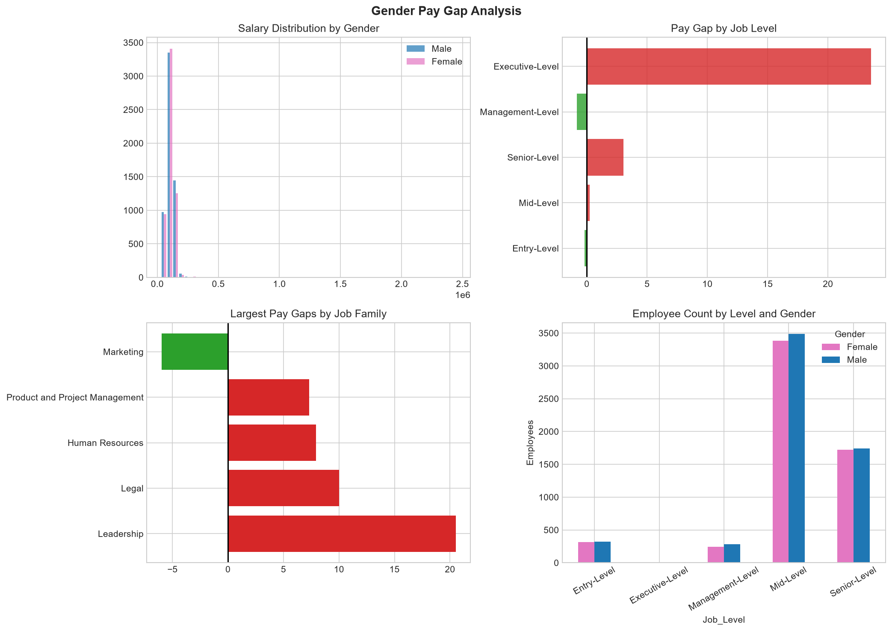
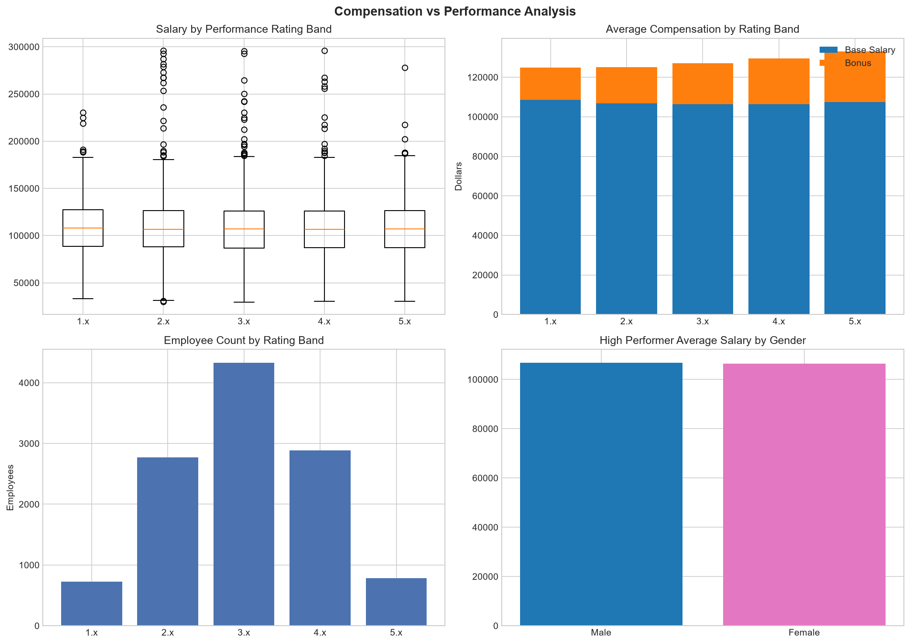
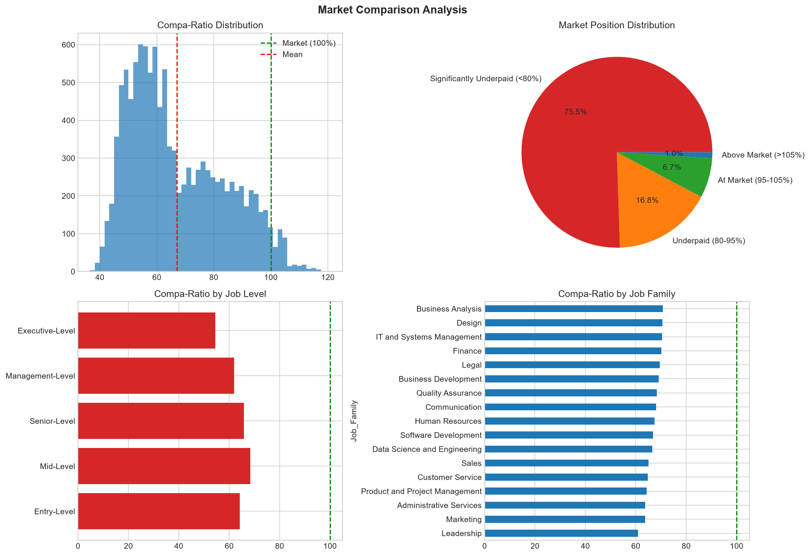
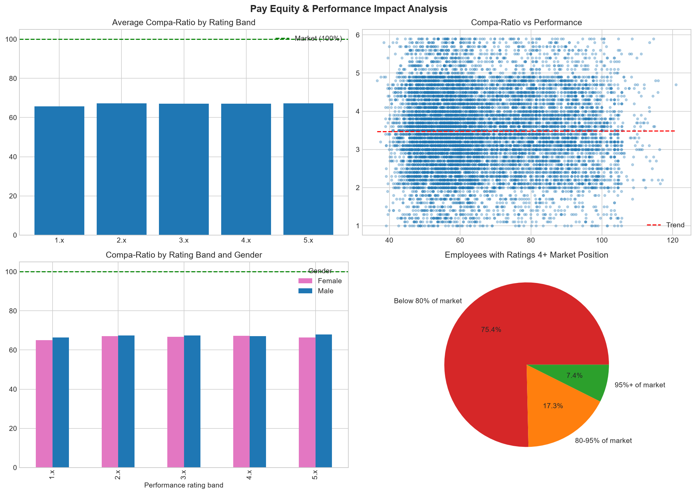
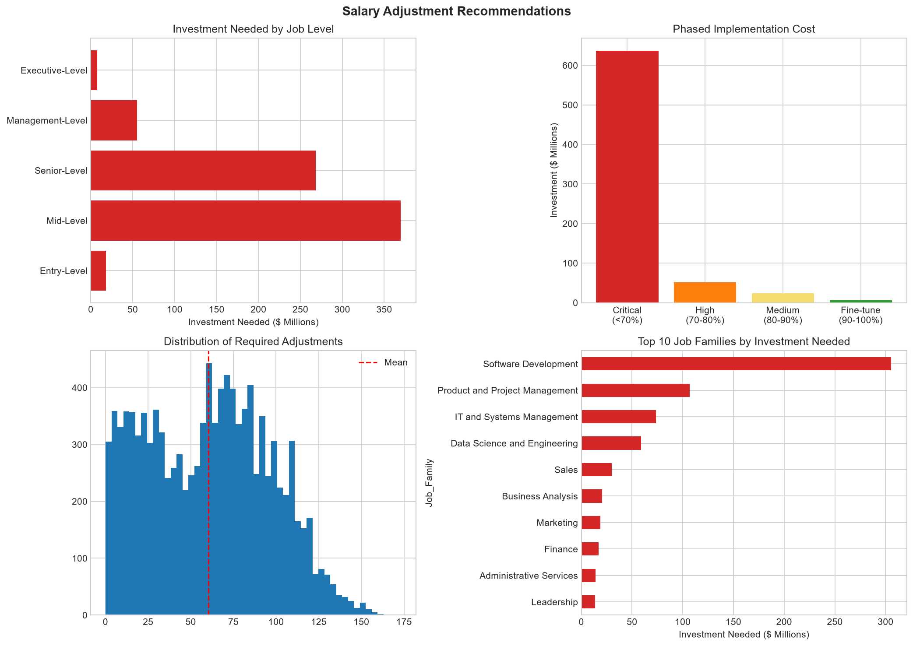

# BananaByte Pay Equity & Compensation Review

> **A portfolio case study in turning employee-level compensation data into a practical review plan.**

Most compensation decisions happen one employee at a time: an offer is stretched to close a hire, a raise is approved to retain someone, and a salary is adjusted during a review cycle. Each decision may seem reasonable on its own. The harder question is what those decisions add up to across a workforce.

This project takes a consolidated look at compensation through five connected lenses: **gender, job level, performance, market position, and potential adjustment cost**. The goal is not to declare that a pay decision is right or wrong. It is to show how an analyst can identify patterns, check the data, and give decision-makers a clearer set of questions to investigate.

**Data transparency:** “BananaByte” is the company name used in this case study. The source and provenance of the supplied employee dataset and market benchmarks have not been documented in the project files. Until that is confirmed, the numbers below should be treated as an analysis of the supplied dataset—not as verified findings about a real employer.

## Executive readout

The supplied CSV contains **11,514 employee records**. The overall unadjusted average-salary gap between male and female employees is **1.71%**. The mean compa-ratio is **67.05%**, and **92.3%** of records are below 95% of the supplied market median. The modelled cost of bringing all below-median salaries up to the supplied median is **$718.9 million**.

Those figures do not, on their own, establish inequitable pay or a required budget. The unusually low market positioning makes **benchmark quality and job matching the first things to validate**. The executive-level gender gap is also a review signal, but comes from only **19 people** (7 women and 12 men). Performance results are provisional because the observed ratings run from 1.0 to 5.9 while the project documentation describes a 1–5 scale.

| Question | Result from the supplied data | Decision-useful interpretation |
|---|---:|---|
| What is the overall gender pay gap? | 1.71% | A starting point for investigation; not an adjusted equal-pay comparison. |
| Where does the gap vary by job level? | -0.83% to 23.58% | The executive result stands out, but that level has only 19 records. |
| How does salary relate to performance? | Correlation: -0.0063 | The data shows almost no linear relationship; confirm the rating scale first. |
| How does average salary compare with market? | Mean compa-ratio: 67.05%; median: 62.62% | Validate market sources and role matches before interpreting the large shortfall. |
| What would a full move to market median cost? | $718.9M for 11,122 records | A simplified scenario, not an approved or recommended budget. |

## The business question

Pay equity, market competitiveness, employee trust, and performance rewards are often reviewed separately. Looking at them together can help an organization decide what to check first:

1. **Equity:** Where are average salaries different by gender, overall and within job levels or families?
2. **Rewards:** Do salary, bonus, and total compensation move with recorded performance?
3. **Market:** How far are salaries from the market median associated with each role?
4. **Talent review:** How many employees rated 4 or above are also below 80% of market?
5. **Cost and sequencing:** What is the estimated base-pay cost of bringing below-market salaries to median, and how might a review be phased?

The analysis is designed as a **screening and decision-support exercise**. It points to where HR or compensation teams could investigate; it does not determine individual pay actions.

## Findings and visual report

All five charts below are included in the repository so the report is readable on GitHub without running the script. They can be regenerated by following [Run the project](#run-the-project).

### 1. Gender pay gap: a small overall figure can hide a subgroup signal

The gap is calculated as:

`(average male salary - average female salary) / average female salary * 100`

| Job level | Male average salary gap relative to female average |
|---|---:|
| Entry-Level | -0.17% |
| Mid-Level | 0.23% |
| Senior-Level | 3.04% |
| Management-Level | -0.83% |
| Executive-Level | 23.58% |
| **Overall** | **1.71%** |

Positive values mean the male average is higher; negative values mean the female average is higher. The overall figure is unadjusted and combines employees across roles and levels. It does not account for tenure, experience, location, role content, or other factors. The executive-level difference is worth checking, but its group size is small (7 women and 12 men), so individual salaries can have a large effect on the average.

The chart also shows the five job families with the largest absolute gaps. Those are useful leads, not a definitive ranking: family-level results should always be read alongside group size and role mix.



### 2. Compensation and performance: check whether ratings connect to rewards

The salary-to-performance correlation is **-0.0063** and the total-compensation-to-performance correlation is **0.0487**. Both are close to zero in this dataset. Among employees with a recorded rating of 4 or higher, the male/female average-salary gap is **0.34%**.

This is not evidence that a reward system is or is not working: job level, role, tenure, rating quality, and bonus policy can all affect the relationship. It does suggest a useful follow-up question: **does the rating scale reliably distinguish performance, and is variable pay intended to reward it?**

**Data-quality issue:** the dataset contains performance values from **1.0 to 5.9**, despite the documented 1–5 scale. Nineteen records have no rating. The current analysis groups ratings into broad bands for chart readability and classifies ratings of 4 or higher as high; confirm the intended scale before relying on these comparisons.



### 3. Market position: validate the benchmark before acting

A **compa-ratio** is `salary / market median * 100`. A value of 100% means salary matches the recorded market median for the role.

| Position relative to market median | Employees | Share |
|---|---:|---:|
| Below 80% | 8,694 | 75.5% |
| 80% to under 95% | 1,929 | 16.8% |
| 95% to 105% | 775 | 6.7% |
| Above 105% | 116 | 1.0% |

The mean compa-ratio is **67.05%** and the median is **62.62%**. **92.3%** of the records are below 95% of the supplied median. Since such a large share appears below benchmark, the first practical step is to verify the market data date, source, geography, job matches, and level mapping. A flawed or stale benchmark could make the whole workforce appear under-positioned.



### 4. Pay position and performance: create a review list, not a risk verdict

The correlation between compa-ratio and performance is **0.0034**, effectively zero in this dataset. The analysis flags **2,764 employees** who have a rating of at least 4 and a compa-ratio below 80%.

That count can help define a targeted validation queue once rating data is confirmed. It does **not** prove those employees will leave or that an adjustment is appropriate. A responsible review would first confirm each employee’s role, level, market match, rating, and compensation history.



### 5. Adjustment scenario: quantify the scale, then phase the review

For each employee below 100% of the supplied market median, the analysis calculates the difference between salary and that median. The resulting **$718.9M across 11,122 records** is a theoretical base-pay scenario—not a budget request or recommendation.

| Review phase | Compa-ratio band | Employees | Estimated base-pay difference |
|---|---:|---:|---:|
| Critical | Below 70% | 7,143 | $636.9M |
| High | 70% to under 80% | 1,551 | $51.8M |
| Medium | 80% to under 90% | 1,335 | $23.6M |
| Fine-tuning | 90% to under 100% | 1,093 | $6.6M |
| **All below median** | **Below 100%** | **11,122** | **$718.9M** |

The critical and high groups together contain **8,694 records** and represent about **95.8%** of the scenario cost. This concentration supports a phased *review*: validate the most extreme market gaps first, then prioritize any confirmed issues using business context. The calculation excludes employer taxes, benefits, bonus effects, and case-by-case decisions. It also assumes the market medians are valid.

The **net salary gap to market** is $717.1M, which differs from the $718.9M adjustment scenario because the net gap subtracts employees paid above market, while the adjustment scenario only sums positive shortfalls for employees below market.



## From analysis to action

The project documentation suggests a practical sequence. These are **proposed investigation steps**, not automated recommendations:

### First: validate the underlying data

- Confirm the dataset’s provenance, snapshot date, and permission to use or publish it.
- Confirm the source and date of each market benchmark and how jobs were matched.
- Review the lowest compa-ratios for incorrect job levels, market matches, or salary inputs.
- Confirm why performance ratings exceed the documented 1–5 scale.

### Then: focus reviews where signals overlap

- Review employees rated 4 or higher and below 80% of market after performance data is validated.
- Investigate gender differences within job levels and job families, adding tenure, hire date, location, and role content where permitted.
- Check subgroup sizes before interpreting large gaps, especially for small groups such as the executive level.

### Finally: plan any confirmed response

- Consider the critical and high phases first, subject to validation and a proper individual review.
- Incorporate medium and fine-tuning cases into regular compensation cycles if supported by policy and budget.
- Define a clear target market-position policy and review pay equity on a recurring schedule.
- Improve the analysis with adjusted statistical methods and richer context before using it for high-stakes decisions.

## How the analysis works

The script follows a single end-to-end flow:

1. Load the employee CSV and convert performance values to numbers.
2. Create derived fields such as compa-ratio, salary gap, and market-position band.
3. Compare salary across gender, job level, and job family.
4. Compare salary and total compensation with performance and compare compa-ratio with performance.
5. Estimate the base-pay difference to market median and group it into four review phases.
6. Save one four-panel chart for each analysis.

The analysis code is kept in [`pay_equity_analysis.py`](pay_equity_analysis.py). The small [`run_analysis.py`](run_analysis.py) file starts the analysis using the CSV in `data/raw/`. A single `PayEquityAnalysis` class groups the data and analysis steps; you can run the project without needing to understand object-oriented programming.

## Run the project

### 1. Install Python

Use Python 3.10 or newer.

### 2. Open a terminal in the project folder

Create and activate a virtual environment (recommended):

```powershell
python -m venv .venv
.\.venv\Scripts\Activate.ps1
```

On macOS or Linux, activate it with:

```bash
source .venv/bin/activate
```

### 3. Install dependencies

```bash
pip install -r requirements.txt
```

### 4. Add the input data and run

Place a permitted-to-use CSV at:

```text
data/raw/BananaByte_Employee_Salary_090923 CleanedData_On_Python.csv
```

Then run the simple launcher:

```bash
python run_analysis.py
```

The launcher prints five headline metrics and saves the charts in `reports/`. You can also run `python pay_equity_analysis.py` directly. The supplied employee CSV is kept local and ignored by Git because it may contain sensitive compensation data.

## Input data

The CSV must include these columns:

`Gender`, `Job_Role`, `Job_Family`, `Job_Level`, `Market_Median`, `Salary`, `Bonus_FY`, `Total_Compensation`, and `Perf`.

The dataset also contains fields such as experience, seniority, education, and location, but the current analysis does not use them to adjust pay comparisons. The gender comparison uses the male/female categories available in this file.

## Scope and limitations

- **Dataset provenance is unconfirmed.** The project files do not establish whether the records are synthetic, anonymized, or real, nor do they identify the market-data source or snapshot date.
- **This is a snapshot.** It cannot show changes in hiring offers, promotions, raises, or attrition over time.
- **Gender gaps are unadjusted.** Comparing averages by one factor at a time does not establish pay differences for comparable work.
- **No significance tests are performed.** Small-group averages can move substantially with a few records.
- **Performance results need a validated scale.** Observed ratings reach 5.9, while the documented scale is 1–5.
- **Correlation is not causation.** The analysis describes association and does not establish that pay affects performance or vice versa.
- **Market comparisons depend on benchmark quality.** Role matching, location, timing, and source can materially change compa-ratios.
- **Adjustment costs are simplified.** They include base-pay differences only and are not an approved budget or individual pay recommendation.
- **Privacy matters.** Employee-level compensation data and even some aggregated results may be sensitive. Publish them only with permission.

## Project structure

```text
.
├── pay_equity_analysis.py
├── run_analysis.py
├── requirements.txt
├── README.md
├── .gitignore
├── data/
│   └── raw/
│       └── README.md                # explains where to put private input data
└── reports/
    ├── 1_gender_analysis.png
    ├── 2_performance_analysis.png
    ├── 3_market_analysis.png
    ├── 4_equity_impact.png
    └── 5_adjustments.png
```

## Tools and next steps

**Tools:** Python, pandas, NumPy, Matplotlib.

**Natural next improvements:** document data provenance and benchmark sources; validate the performance scale; add an adjusted pay-equity model with confidence intervals; include subgroup counts and sample-size warnings in every report; compare multiple time periods; and export a review-ready summary table.
